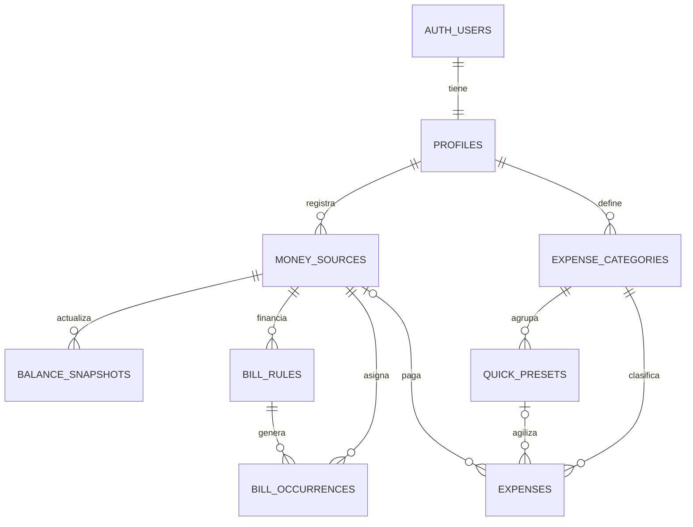

# Modelo inicial de datos

Este diseño cubre el primer alcance de Saldo Claro: fuentes de dinero ingresadas manualmente, saldos observados, cuentas mensuales o puntuales y gastos rápidos por categoría.

La migración SQL está en `supabase/migrations/202611080001_initial_schema.sql`. Es un archivo de proyecto; todavía no se ha aplicado a una instancia de Supabase.

## Relaciones

## Tablas principales

- **`profiles`**: perfil mínimo ligado al usuario de Supabase Auth. Guarda solo el nombre visible; Auth administra correo, contraseña y sesión.
- **`money_sources`**: una fila por cuenta bancaria o beneficio. `can_pay_bills` indica si esa fuente puede cubrir cuentas. `restriction_note` explica restricciones al usuario.
- **`balance_snapshots`**: historial de saldos ingresados manualmente. El saldo mostrado se obtiene del último registro de la fuente.
- **`bill_rules`**: regla de una cuenta recurrente mensual, como nombre, monto estimado, fuente de pago y día del mes.
- **`bill_occurrences`**: cuenta concreta de un periodo, con su monto, vencimiento y estado. Si `rule_id` está vacío, es un pago puntual. La clave única de regla y periodo evita crear la misma cuenta mensual dos veces.
- **`expense_categories`**: categorías que pertenecen al usuario, como compras pequeñas, colación o transporte.
- **`quick_presets`**: botones de captura rápida, por ejemplo “Chocolate” y “Bebida”, asociados a una categoría.
- **`expenses`**: gasto registrado con monto, fecha, categoría y, opcionalmente, la fuente y el atajo utilizados. Conserva el texto del atajo en `label` aunque luego se cambie su nombre.

Los montos se guardan como pesos chilenos enteros (`numeric(14,0)`). No se guardan números de tarjeta, contraseñas bancarias ni conexiones a bancos.

## Cálculo inicial

Para una cuenta bancaria:

`disponible estimado = último saldo registrado − cuentas pendientes asignadas a esa cuenta`

Para un beneficio que no puede pagar cuentas, no se descuentan cuentas pendientes. Los gastos rápidos se resumen por categoría y quedan separados de ese cálculo en la primera versión. Si luego se quieren descontar del disponible, hará falta conciliar los gastos al ingresar un nuevo saldo para no restarlos dos veces.

## Repetición mensual

Una regla mensual genera como máximo una ocurrencia por periodo mediante la función SQL `ensure_monthly_bill_occurrences`, que el dashboard llama al abrirse. Si el día configurado es 29, 30 o 31 y el mes no tiene ese día, la generación usa el último día del mes. Las cuentas pasadas se conservan como ocurrencias; la regla se puede desactivar para evitar meses futuros.

## Acceso y conservación

Las tablas privadas incluyen `user_id`, tienen Row Level Security y restringen las filas al usuario autenticado. La migración también valida que una cuenta o beneficio asignado a una cuenta permita pagarla. Si una fuente ya tiene cuentas mensuales activas o pagos pendientes, primero hay que reasignarlos o desactivarlos antes de marcarla como restringida. Las fuentes y categorías se desactivan en lugar de eliminarse, para conservar el historial. Las credenciales de servicio no deben estar en el navegador.

Al registrarse, un trigger crea cuatro categorías iniciales y sus atajos para ese usuario. No son datos globales compartidos. Las fuentes de dinero y los montos iniciales los agrega la persona en el dashboard.
